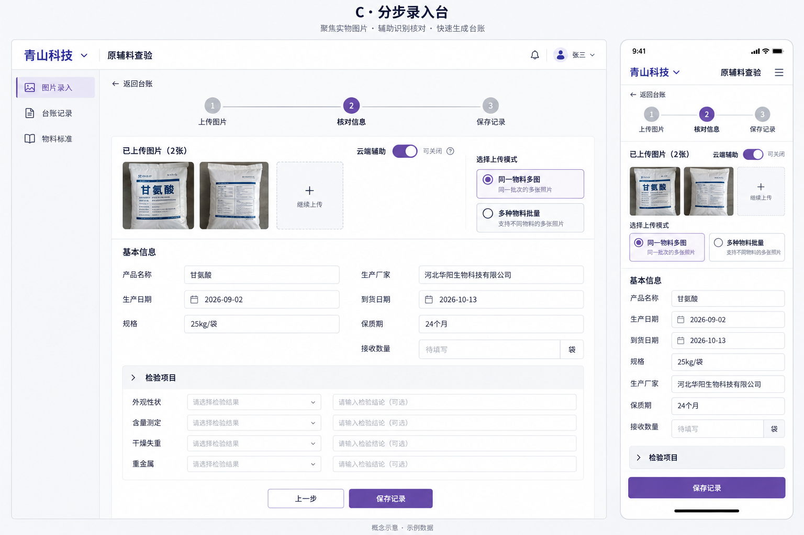

# 原辅料查验系统 UI 设计备选

状态：用户于2026年10月13日选择 B 图片核对台，台账列表结合 A 的表格布局，全站统一 B 青色。C 不作为第一版主流程。最终设计规则已写入《项目方案.md》。图片是设计概念，不是可运行界面。示例包装、姓名、检验项目及数据仅用于展示布局，不构成新增需求。方案使用内置 imagegen 生成，未编写前端代码。

## 共同设计要求

- 公司台账位于顶层导航，先进入台账再录入，不增加公司表单字段。
- 电脑和手机共享业务能力，布局根据屏幕调整。
- 本地 OCR 先运行，云端辅助默认开启且可关闭，失败仍可继续。
- 业务字段可空，不自动填合格，检验项目来自所选标准方案。
- 图片和核对表单要便于相互查看，操作按钮使用清晰中文。
- 正式页面完整字段遵循模板；概念图为了可读性只展示部分字段。
- 手机需要同时提供保存待核对记录和标记已核对的方式，不受概念图中按钮数量限制。
- 接收数量不固定为袋或 kg，应允许本次业务所用单位。
- 通知、帮助、统计及宣传语等概念图装饰不自动纳入第一版。

## A 台账工作台

布局：左侧导航，中间记录表格，右侧详情抽屉；手机将表格转为记录列表。

示意：导航 | 记录表格 | 当前记录详情。

配色：白色 #FFFFFF、浅蓝灰 #F3F6FA、深灰蓝 #263447、主蓝 #2458A6、提示琥珀色 #B87919。

字体：中文无衬线，标题约 22px，正文约 15px；日期和数值列整齐对齐。

优点：接近台账习惯，便于查询、多选和批量导出。取舍：大图核对空间较小，需要展开详情。

## B 图片核对台

布局：顶部台账导航，主体左侧原图与缩略图，右侧识别表单，底部固定保存操作；手机原图可折叠，字段纵向展示。

示意：图片队列 | 原图 | 待核对字段。

配色：白色 #FFFFFF、淡蓝 #F4F8FB、深蓝灰 #203548、主青色 #087F8C、提示琥珀色 #B97719。

字体：中文无衬线，字段名清晰，正文约 16px，来源标记作为次要信息。

优点：原图和字段容易对应，适合本项目的识别后人工核对。取舍：单页主要处理当前记录，批量查询需进入台账列表。

推荐以此为核心录入布局，台账列表可吸收 A 的表格组织方式。

## C 分步录入台

布局：上传图片、核对信息、保存记录三个步骤，表单分组呈现；手机使用相同顺序。

示意：上传 → 核对 → 保存；当前步骤集中展示必要内容。

配色：白色 #FFFFFF、浅灰 #F6F7F9、深灰 #303548、主紫色 #6750A4、提示琥珀色 #B7791F。

字体：中文无衬线，宽松行距和较大操作区，主要操作适合手指点击。

优点：新用户容易理解，手机逐条录入直观。取舍：电脑连续核对大量图片时，步骤切换更多。

## 生成提示摘要

三张图均要求：中文原辅料查验网页，电脑主视图与手机视图并排，公司为导航上下文，使用甘氨酸示例，日期与规格可编辑，接收数量留空，云端辅助可关闭，不增加批号字段，不自动填合格，浅色且无统计大屏。

A 强调蓝色、台账表格及详情抽屉；B 强调青色、原图与字段并排；C 强调紫色、分步引导及手机表单。正式设计在用户选择后统一字体、颜色和组件，并按已确认业务规则补齐细节。
