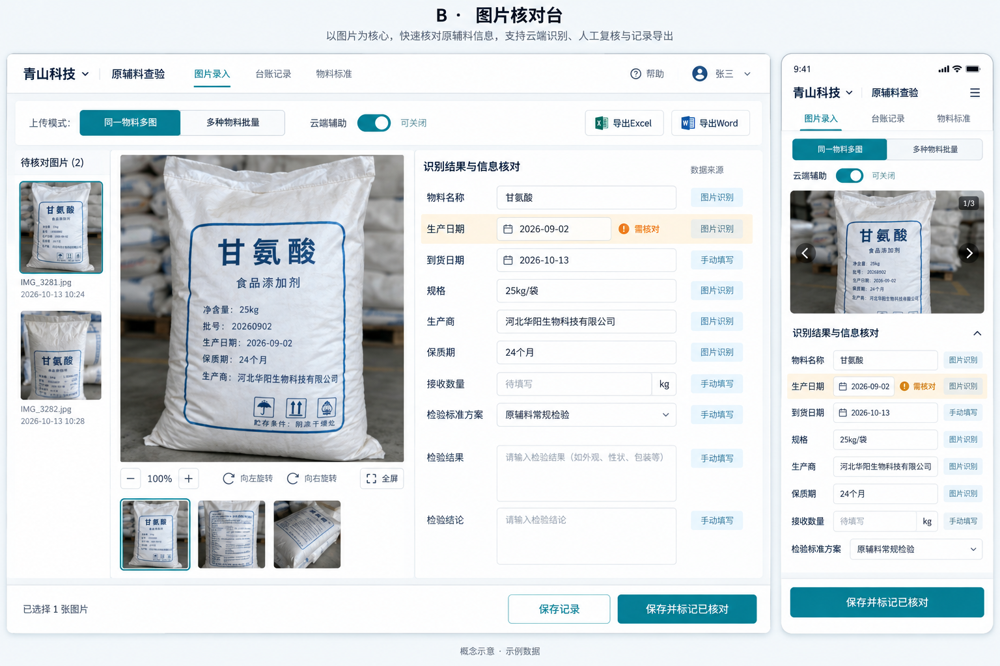
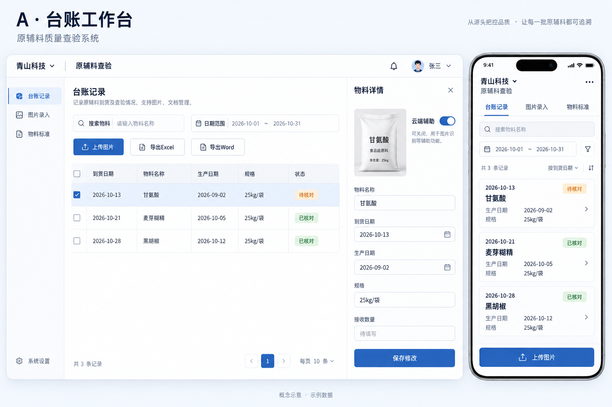

# 原辅料智能查验与报告管理系统项目方案

版本：1.1，2026年10月14日。用户已授权开发，本地试用版正在验收。补充决定及实际运行方式见《开发执行记录》和《本地运行与模板维护》。

本方案整合三轮需求评审的 17 项决定和已选 UI 方向，是第一版开发与验收的依据。记录术语见 [业务术语](../CONTEXT.md)，决策依据见 [需求评审](需求评审.md)。

## 1 项目目标

通过包装照片识别原辅料信息，结合人工核对、手动补充和维护的检验标准，生成原版式 Excel 查验台账及每条记录对应的 Word 检验报告。

电脑与手机使用同一网页系统，多人共享记录。先在本地电脑测试，用户满意后部署公司服务器并支持外网访问。

基础识别在本地运行，智谱 GLM-4.1V-Thinking-Flash 仅辅助。云端不可用时，本地识别、手工录入、保存和导出均正常使用。

## 2 账号与公司台账

首次安装由用户设置首个管理员账号及密码，初始化完成后关闭该入口。后续账号由管理员创建、分配角色、停用及重置密码，不开放自行注册或自行提升权限。

| 操作 | 管理员 | 普通用户 |
| --- | --- | --- |
| 上传、识别及创建记录 | 可以 | 可以 |
| 查看、导出所有公司的记录 | 可以 | 可以 |
| 修改或核对自己创建的记录 | 可以 | 可以 |
| 修改或核对其他人的记录 | 可以 | 不可以 |
| 作废记录 | 可以 | 不可以 |
| 建立与维护公司台账 | 可以 | 不可以 |
| 维护共享物料、检验标准及单位资料 | 可以 | 选择使用 |
| 管理账号与云端配置 | 可以 | 不可以 |

管理员先建立“青山科技”“味源食品”等公司台账。人员选择进入台账后，才能上传识别及录入记录。公司名称是台账上下文和导出工作表名，不增加记录表单字段或 Excel 列，不设置“未分类”工作表。

所有公司共享物料和检验标准方案库。公司台账不构成数据查看权限隔离。记录创建人不会因管理员修改而改变；权限必须在服务端执行。

## 3 操作流程

登录 → 进入公司台账 → 选择上传模式 → 上传图片 → 本地识别 → 可选云端辅助 → 调整分组与核对字段 → 选择标准方案 → 填写检验结果 → 保存或标记已核对 → 导出。

| 上传模式 | 处理方式 |
| --- | --- |
| 同一物料多张图片 | 综合同一到货记录的多角度图片，形成一组候选信息 |
| 多种物料批量上传 | 建议图片分组，每组形成一条候选记录，人员可调整 |

支持电脑文件选择和拖拽上传、手机拍照与相册上传。图片支持预览、放大、旋转和移除。原图保留，识别用副本可作必要的方向与透视处理。

保存前允许移动图片、合并分组和拆分分组。无法判断的图片交由人员分组；云端失败时仍可本地识别并手动分组。

同一物料有多个生产日期时，由录入人员决定是否合并。合并后列出多个日期，接收数量填合计，共用一套检验结果并生成一份报告；检验结果不同则拆开。系统不从照片净含量推算到货总量。

保存后不提供专用合并拆分操作，通过有权限的修改或管理员作废后重建处理，保留原记录历史。

## 4 字段与填入规则

Excel 保留现有 13 列。字段允许手动修改和留空，空值不阻止保存或核对，导出仍为空白；不自动填入“合格”“不适用”或空值代码。

| 模板列 | 填入规则 |
| --- | --- |
| 到货日期 | 首次录入默认北京时间当天年月日，可修改、清空；以后编辑不自动刷新日期 |
| 物料名称、型号 | 图片识别，允许修改、匹配共享物料资料 |
| 生产日期 | 图片识别，允许多个日期；照片水印日期不能代替 |
| 规格 | 图片识别，保留包装形式和单位 |
| 供应商或生产商 | 默认供应商，没有供应商时填生产商，保存前可修改 |
| 地址 | 优先识别，可选择维护资料、手填或留空 |
| 联系方式 | 优先识别，可选择维护资料、手填或留空 |
| 保质期 | 优先识别，保留年、月等单位 |
| 接收数量 | 本次手填，保留数量及单位，不能用单包净含量代替 |
| 随车证件 | 人员核对后填写或选择，可为空 |
| 感官检验 | 人员填写，不能由标签上的合格声明替代 |
| 抽检项目 | 根据选择的物料检验方案带入，可按本次情况调整 |
| 备注 | 手动填写，可为空 |

识别过程区分供应商与生产商。若名称栏使用供应商，但地址或电话使用生产商资料，允许保留并在每个对应单元格注明“生产商”。例如“生产商：河北某地”“生产商：0311-……”。不因此改变名称栏的单位。

不新增独立批号录入栏、筛选项或 Excel 列。批号可保留在原图及原始识别文字中，作为分组冲突参考，但不自动写入其他字段。

系统管理信息包括记录标识、台账关联、创建人、修改时间等，不属于新增的模板业务字段。具体 Word 字段按原模板完整核对，不凭空添加。

## 5 本地 OCR 与云端辅助

### 基础识别

主候选为 PaddleOCR，对照测试 RapidOCR 的明确模型配置。两者并非完全独立算法，比较需固定模型、预处理及图片尺寸。实测后选一个默认引擎，第一版不同时维护两套完整流程。

本地识别提取文字及位置，再按模板字段整理。模型下载完成后，基础识别无需云端接口。先验证 CPU 运行，不要求为辅助模型购买显卡。

### 云端辅助

使用智谱 GLM-4.1V-Thinking-Flash。默认开启，录入人员可关闭；界面明确显示启用后会将相关图片发送给智谱。

云端只辅助整理字段、核对疑点、理解复杂布局及建议分组。管理员在服务端配置密钥，浏览器不持有密钥。不自动切换收费模型；若免费服务不可用，退回本地流程。

本地结果先展示，云端结果完成后作为建议补充。超时、限流、网络中断或密钥失效不阻止人员保存，不无限等待或重复调用。云端失败可以按需重试。

### 人工控制

- 原图及原始识别结果可查看，字段标识来源。
- 两路结果冲突时展示差异，不静默覆盖。
- 重新识别和迟到的云端结果不覆盖人工修改。
- 缺失信息留空，不根据常识编造日期、电话或单位名称。
- 模型不填写实际检验结果和判定结论。
- 图片文字只作为待提取内容，不作为系统操作指令。

官方目前列该型号为免费视觉模型，但服务政策不是永久可用保证，系统可关闭该辅助依赖。参考 [智谱模型说明](https://docs.bigmodel.cn/cn/guide/models/free/glm-4.1v-thinking-flash)。

## 6 物料和检验标准

管理员维护共享物料名称、型号、常用别名，以及具名的检验标准方案。每套方案包含项目、标准规定、单位和排列顺序。同名同型号物料可以有多套方案。

- 只有一套方案时自动带入；多套时由人员选择。
- 不选方案或未维护物料时，仍允许留空保存。
- 检验结果、判定结论每次手填，可以为空。
- 维护资料与照片信息有差异时，不直接覆盖。
- 已保存记录保留当时采用的项目和标准；修改公共方案不改变历史报告。
- 若重新选择方案会影响已填结果，须明确提示，不能把旧结果错配给新项目。

共享单位资料用于补充供应商、生产商、地址和联系方式，不替代包装中的明确证据。检验员及批准人按报告原有栏位手填或留空，不引入审批流程、自动签名或电子签章。

## 7 记录状态和查询

记录状态为待核对、已核对、作废。首次保存可为待核对，也可由创建人直接保存并标记已核对；记录核对人及时间。

已核对不表示全部字段填写，也不表示检验合格。创建人和管理员均可修改有效记录，修改后回到待核对并保留修改历史。管理员可以作废，作废记录保留以供查阅，不参与导出；第一版不提供永久删除或恢复作废记录入口。

在公司台账内按到货日期范围、物料名称、供应商或生产商、创建人和状态筛选。普通用户查看他人记录时为只读。多人同时编辑时检查版本变化，避免无提示覆盖。

## 8 导出规则

默认选取已核对的有效记录；待核对记录提示后允许导出，作废记录不导出。普通用户可导出所有可查看的有效记录。

| 格式 | 生成规则 |
| --- | --- |
| XLSX | 所选记录按公司分工作表，公司名称为表名，每条记录一行，保持模板 13 列 |
| DOCX | 每条记录一份报告，使用该记录保存的检验项目和标准 |
| ZIP | 批量导出 Word 时分别生成并打包 |

Excel 参考空白模板和已填写示例，保留标题、列顺序、边框、字体、对齐、换行与打印设置。公司名称作为工作表名时需满足 Excel 的名称限制，建立或改名时提示调整，不静默改成另一家公司。

旧版 DOC 模板转换为 DOCX 后逐页核对，输出以 Word/WPS 打开和打印版式正确为准。检验项目多时合理分页，不截断内容，不自动写入业务字段之外的状态或提示。

导出不改变记录状态。修改后重新导出采用最新保存内容；已下载的旧文件不会被远程更新，历史修改可在系统查阅。原始办公文件不被覆盖。运行模板在专用 templates 文件夹，保留预制签名图片，可用 Word/WPS 更换，每次导出读取最新模板。Word“生产日期批号”填生产日期，格式为 2026.01.14，独立批号留空。

## 9 已选 UI 设计

采用 B 图片核对台作为录入主布局，A 台账工作台作为列表布局，全站统一 B 的青色，不采用 C 的分步主流程。

| 页面 | 布局与操作 |
| --- | --- |
| 登录与公司入口 | 登录后进入可选公司台账，无台账时由管理员先建立 |
| 台账列表 | A 的表格布局，筛选、多选、状态、导出及上传入口；他人记录只读 |
| 图片录入与核对 | B 的左侧图片及缩略图、右侧字段及检验项目，底部保存操作 |
| 公共资料 | 物料、标准方案、单位资料，由管理员维护 |
| 管理页面 | 公司台账、账号、角色和云端配置，普通用户不显示管理入口 |

电脑端字段区域分基本信息、随车证件与感官检查、检验项目等组，不要求一次塞入全部内容。提供“保存记录”和“保存并标记已核对”，空值均可保存。

手机端原图可展开或折叠、字段纵向排列，列表转为简洁记录列表，保存按钮放在便于点击的位置；保留保存待核对及标记已核对两种操作。

设计色值：主青色 #087F8C，背景 #F4F8FB，内容白色 #FFFFFF，正文 #203548，待核对提示色 #B97719。中文无衬线字体，正文约 16px；状态同时显示文字，不只依靠颜色。

基础交互包括清晰焦点、可读对比度、加载与失败提示，以及手机触控区域。表格完整内容可横向滚动，避免手机把所有列挤在一行。

参考图是概念示意，包装、人员、检验项目和部分标签不作为正式字段定义；不增加图中的宣传语、通知中心或统计模块。正式实现以本文规则为准。

## 10 技术方案

以下是拟采用的实施选型，业务规则不依赖某一个 OCR 引擎。

| 部分 | 技术选择 | 用途 |
| --- | --- | --- |
| 前端 | Vue 3、TypeScript、Vite、Element Plus | 电脑及手机网页，按已选设计定制样式 |
| 后端 | Python、FastAPI | 权限、记录、识别任务、导出 |
| 数据库 | PostgreSQL | 本地及正式环境保持同类数据库 |
| 数据访问 | SQLAlchemy、Alembic | 数据读写和结构迁移 |
| 图片处理 | Pillow，必要时 OpenCV | 方向与识别副本处理 |
| 基础 OCR | RapidOCR 3.10 + PP-OCRv6 small + ONNX Runtime，依据本机实测选择 | 本地文字识别 |
| 云端辅助 | 智谱指定免费型号 | 可关闭的字段与图片辅助 |
| Excel | openpyxl | 从模板生成 XLSX |
| Word | python-docx-template、python-docx | 从核对后的模板生成 DOCX |
| 文件 | 本地或服务器专用目录 | 原图、模板和导出文件 |
| 部署 | Docker Compose、Nginx、HTTPS | 公司服务器运行与外网入口 |

采用一个业务后端和持久化任务状态，识别后台排队、限制并发，页面显示进度。第一版不引入微服务或额外的大规模任务平台。云端失败与本地任务状态独立，不把辅助失败当作整次识别失败。

数据主体包括用户、公司台账、共享物料、标准方案及项目、单位资料、记录、记录所用标准快照、图片、识别任务与修改历史。供应商及生产商资料的来源须保留，支持正确生成单元格标注。

登录凭据按安全方式存储；图片与导出下载遵循登录权限，密钥仅在服务端使用。并发更新、图片上传与云端返回分别在相应边界检查，不让错误数据进入记录。

参考项目：[PaddleOCR](https://github.com/PaddlePaddle/PaddleOCR)、[RapidOCR](https://github.com/RapidAI/RapidOCR)、[DOCX 模板工具](https://docxtpl.readthedocs.io/en/latest/)。锁定实际采用的版本及模型，保留相应开源许可说明。

## 11 部署与环境

本地测试：电脑浏览器访问本机，手机连接同一局域网；电脑保持开机。先测试 CPU OCR，整机 16GB 内存和 SSD 是规划建议，不是已核实的当前硬件或性能保证。手机优先使用系统拍照与相册上传入口，实测常用浏览器。

正式部署：用户本地验收满意后，确认公司服务器系统、资源和外网入口，再配置域名、HTTPS及备份。迁移需要保留的账号、记录、图片、资料、模板和配置。验证一次备份恢复，模型运行在服务器，手机无需本地算力。

本地与正式部署分别验收。当前尚未确认服务器环境，不能提前承诺吞吐量或访问速度。

## 12 开发步骤

| 阶段 | 工作 | 完成依据 |
| --- | --- | --- |
| 1 模板与环境核对 | 完整读取 Word、转换并检查版式；核对 Excel 字段、电脑资源 | 字段映射与模板可检查，无新增业务列 |
| 2 识别样本验证 | 对照 OCR 配置，比较智谱辅助前后结果、耗时和占用 | 基于实际照片选择默认 OCR，明确错误类型 |
| 3 基础系统 | 管理员初始化、公司台账、账号权限、记录增改查 | 可登录、进入台账、按创建人限制修改 |
| 4 公共资料 | 共享物料、多套标准、单位资料、记录快照 | 单套带入、多套选择、历史不随公共资料改变 |
| 5 上传与核对 | 两种上传模式、分组、本地 OCR、云端辅助及选定 UI | 手机电脑可走通流程，云端失败不阻断 |
| 6 文档导出 | XLSX、DOCX、ZIP，状态筛选和打印检查 | 内容、数量、空值和版式正确 |
| 7 本地试用 | 真实图片、多账号、手机与电脑操作 | 修复问题，用户验收满意 |
| 8 公司部署 | 数据迁移、外网 HTTPS、备份与恢复 | 外网可用，数据与模板完整 |

开发顺序可在保持验收边界的情况下调整。本地试用完成前不自动部署公司服务器。本文未承诺未经验证的工期或准确率。

## 13 验收标准

| 检查项 | 必须达到的行为 |
| --- | --- |
| 权限 | 普通用户可查看和导出他人记录，服务端拒绝修改或核对他人记录 |
| 公司台账 | 先进入台账再录入，导出按公司表名分表，无公司业务列或未分类表 |
| 空值与日期 | 业务字段可空，到货日期默认当天且可改；导出空值保持空白 |
| 多图分组 | 保存前可自由调整，多个日期合并列出且数量合计，共用结果；结果不同拆开 |
| 资料来源 | 供应商记录可使用生产商地址和电话，对应单元格明确标注 |
| 多套标准 | 单套自动带入，多套手选，不选仍可保存；公共修改不影响历史 |
| 核对与修改 | 创建人或管理员核对；修改回到待核对，保留修改历史 |
| 导出状态 | 默认已核对；待核对提示后可导出；作废不能导出 |
| 云端失败 | 关闭、断网、超时、限流均不阻断本地识别和手动录入导出 |
| 人工优先 | 重新识别及迟到结果不覆盖已修改字段，不自动填写检验合格 |
| 文件输出 | 每条记录一份 DOCX，批量数量正确，Excel 列及公司分表正确 |
| 版式 | Word/WPS 打开和打印无截断、错位；Excel 换行、标题及打印设置符合模板 |
| 迁移 | 账号、记录、原图、方案快照及模板完整，备份能够恢复 |

建议使用约 20～30 组代表照片，包含清晰、倾斜、反光、小字、多角度和冲突信息。逐字段比较正确、漏识别、误识别，以及辅助模型纠正和新增错误，记录单张与多图耗时。不将不同数据集的官方分数当成本项目准确率。

自动测试重点覆盖权限接口、状态变化、方案快照、云端失败降级及导出内容；版式和真实手机操作由实际文件与设备验证。

## 14 第一版范围

包含公司台账、账号权限、共享资料、图片上传分组、本地识别、可关闭的智谱辅助、人工核对、记录查询、历史修改、作废和模板导出。

暂不包含库存采购、审批流、电子签章、微信小程序、模型训练、本地大语言模型、通用模板设计器、已保存记录自动合并拆分及历史 Excel 批量导入。示例 Excel 用于对照格式，不自动作为待导入数据。

## 15 确认与实施边界

业务评审和 B 加 A 的 UI 组合已确认。请用户审阅本文后确认最终项目方案；该确认前不编写项目代码、不安装项目依赖、不接入真实云端密钥或部署服务。

后续模板核对、硬件检查和样本验证属于实施阶段的事实验证。如果发现原模板或资源条件无法支持本文已确认行为，应说明具体差异后调整，不静默删除功能或改变字段规则。
